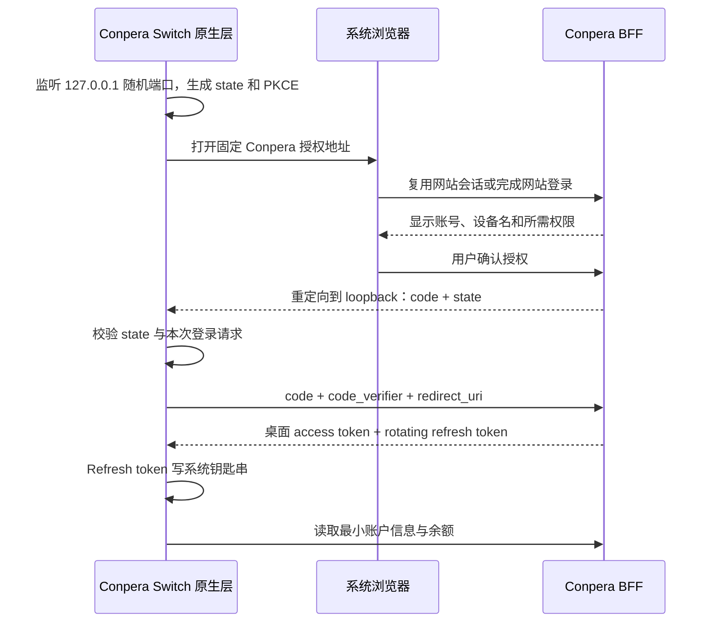

> 历史设计与验收记录；1.0 当前实现和构建入口见 [README](../README.md)。

# Conpera Switch 登录态设计（历史方案）

**2026-10-08 更新：** 当前已实现的 `/api/switch/*` 契约见 [BETA.md](BETA.md) 和相邻后端工作树的 `docs/architecture/conpera-switch.md`。以下是此前方案，不代表已部署接口。当前内测采用从属于中央网站会话的专用桌面令牌（最长 7 天，无独立 refresh token）；网站退出会使桌面失效，授权包含本人密钥读取与原生配置写入。

状态：2026-10-06 的生产登录态设计与本地 Demo 契约。Demo 使用本地模拟身份服务、模拟账号和演示余额；没有连接生产登录、申请真实网站令牌或修改网站服务。下文把本地 Demo、已读网站源码与待实现生产方案分开记录。实际运行验证以项目 README 和交付记录为准。

## 产品边界

应用只做三件事：切换 Claude Code / Codex 的本站与原机配置，选择渠道和 Key，查看 Conpera 账号与余额。账号页面、充值、改密码继续在网站完成。

生产设计中，本地配置能力与账号会话分开：恢复原机配置不需要登录；手动填入已有 Key 可以配置客户端；网站登录用于同步本人 Key 的元数据和读取余额。模型 API Key 与账号登录凭据不是同一种凭据，不能用模型 Key 替代账号授权。当前 Demo 只在页面中模拟配置状态，添加 Key 仅生成演示名称、渠道与尾号元数据，不提供真实 Key 输入，也不读写本机配置。

## 已有代码：静态核验结果

只读检查了相邻仓库 `conpera-code` 的 `AGENTS.md`、`apps/bff/src/sessionAuth.ts`、`sessionAuthStore.ts`、`sessionPolicy.ts` 与 `server.js` 的相关路由。未读取真实环境文件、Cookie、Key、数据库或其他凭据，也未验证生产运行状态。

| 已有能力 | 源码事实 | 桌面接入限制 |
| --- | --- | --- |
| 邮箱登录、注册、Google 登录 | `server.js` 提供 `/api/auth/login`、`/api/auth/register`、`/api/auth/google/*`；成功后建立 BFF 会话 | 桌面程序应复用系统浏览器中的网站登录，不收集网站密码 |
| 网站会话 | 浏览器持有不透明会话 ID；Cookie 为 HttpOnly、SameSite=Lax，Secure 由运行配置决定 | 不读取或复制浏览器 Cookie，不假定当前部署的 Secure 配置 |
| 会话续期 | `sessionAuth.ts` 有单次刷新、版本竞争保护、撤销队列及不确定状态处理；`sessionAuthStore.ts` 加密保存上游凭据 | 续期受 `SESSION_REFRESH_ENABLED` 控制，仅源码存在不代表生产已开启 |
| 会话期限 | 可续期模式绝对期限 30 天；无刷新模式最多 7 天且受访问令牌期限限制 | 这些是现有网站策略，不等于桌面令牌策略 |
| 身份 | `GET /api/me`、`GET /api/session` | 当前没有桌面 scope 或 audience 鉴权 |
| 余额 | `GET /api/balance`，通过 BFF 读取并形成账户余额视图 | 应复用余额业务逻辑；不能将模型 Key 当作余额授权凭据 |
| 密钥与渠道 | `GET /api/keys`、`GET /api/key-channels`；Key 列表隐藏完整密钥；另有 `POST /api/keys/:id/reveal` 和 `POST /api/keys/:id/ccswitch-import` | 后两者有来源与归属校验；不能为了桌面接入直接放宽网站的 Origin 防护 |
| 服务端渠道变更 | `PATCH /api/keys/:id/channel` 会修改该 Key 的上游分组 | 会影响所有使用该 Key 的客户端，不只是当前电脑 |
| Bearer 兼容 | `sessionAuth.ts` 会把现有 Bearer token 交给上游校验 | **不能**直接把新桌面 access token 传入此分支，它不是上游 token |

在本次检查的代码中未发现下面提出的 `/api/desktop/*` 授权与令牌端点；它们全部是待实现契约。

## 建议的登录流程

采用系统默认浏览器 + 授权码 + PKCE S256。桌面应用是公开客户端，没有可安全内置的 client secret。网站登录 Cookie 留在浏览器里；BFF 为本设备签发独立、可撤销的桌面会话。



1. 原生层先成功绑定 `127.0.0.1` 的系统分配端口，再打开浏览器。使用固定回调路径 `/oauth/callback`，不监听 `0.0.0.0`，不使用 `localhost` 的不确定解析。
2. `state` 使用至少 32 字节密码学随机值；`code_verifier` 使用密码学随机值并满足 PKCE 长度要求；生成 `S256` challenge。它们只留在原生进程内存，登录成功、取消或超时后销毁。
3. 授权入口固定在 `https://code.conpera.ai`。浏览器没有会话时先走已有网站登录。登录后的返回位置使用服务端保存的授权事务 ID，避免任意 `return_to` 和开放重定向。
4. 浏览器展示“授权 Conpera Switch”，显示当前账号、设备名与“读取账户和余额”权限；用户可更换账号。确认动作使用同源 POST、CSRF 防护及网站会话校验，GET 不静默创建授权。
5. BFF 严格校验 `client_id` 与回调模板。仅允许 `http://127.0.0.1:{port}/oauth/callback`；端口来自本次请求，其余组成严格匹配；拒绝其他主机、路径、userinfo、fragment 和任意业务重定向。授权码同时绑定精确回调 URI、用户、scope、client_id、PKCE challenge 和事务。
6. 只把一次性授权码和 `state` 放入回调。授权码建议 60 秒有效、一次消费，事务建议 5 分钟过期。Token、完整模型 Key、网站 Cookie 不出现在 URL。
7. 原生层校验 state 后，通过 HTTPS 直接交换令牌；BFF 在一个事务中校验并消费授权码。交换失败不会应用任何配置。回调页不加载第三方资源，并设置 `Cache-Control: no-store`、`Referrer-Policy: no-referrer`。
8. 客户端只接受本次发起的登录结果；迟到、重复、state 不匹配的回调不会覆盖当前账号。成功或用户取消后关闭监听端口。

以上是桌面客户端的生产设计。浏览器 Demo 与 Mac 应用 Demo 的模拟授权窗口都不是系统浏览器 OAuth 实现。

## 待实现的最小接口与权限

以下路由名是建议契约，**不是现有线上接口**。桌面 API 单独解析自己的 token、audience、scope 与撤销状态，然后复用 BFF 内部账户/余额业务服务；不把 token 转发到上游。

| 待新增端点 | 调用方与用途 | 最小权限 |
| --- | --- | --- |
| `GET /api/desktop/authorize` | 系统浏览器建立并展示授权事务 | 现有网站 Cookie；有效的 PKCE 请求 |
| `POST /api/desktop/authorize/decision` | 浏览器同意或拒绝本次授权 | 网站 Cookie + CSRF + 本人事务 |
| `POST /api/desktop/token` | 原生层交换授权码或轮换 refresh token | PKCE code verifier，或有效 refresh token |
| `POST /api/desktop/revoke` | 原生层撤销当前桌面会话与 token family | 当前会话的 refresh/access token |
| `GET /api/desktop/me` | 获取当前账号 ID、展示名、脱敏邮箱 | `profile:read` |
| `GET /api/desktop/balance` | 返回人民币可用余额和更新时间 | `balance:read` |
| `GET /api/desktop/key-options` | 列出本人可用的渠道与脱敏 Key 元数据 | 可选的 `keys:read` |
| `POST /api/desktop/config-grants` | 用户选定本人 Key 后获取单次配置交付凭据 | 单独授权的 `config:apply`，精确绑定 Key 与客户端 |
| `POST /api/desktop/config-grants/consume` | 原生层一次消费交付凭据并取得客户端配置 | 原桌面会话 + 短期单次 grant；不能只凭 grant 匿名领取 |

首期只必须实现登录、身份、余额和撤销；已有 Key 可手动录入。自动同步密钥选项与配置交付是第二步，不需要做完整 Key 管理后台。若首期仍决定支持自动配置，应同时实施 Key 归属校验、最小权限授权与原生层安全存储，不能只补一个 reveal 按钮。

默认只请求 `profile:read balance:read`；选择“从账号导入 Key”时再请求 `keys:read config:apply`。令牌 audience 固定为 `conpera-switch`，这些权限不包含支付、充值写入、后台管理或任意账户操作。

对于“切渠道”，极简版本优先选择该渠道对应的已存 Key，并更新本机配置。避免暗中调用现有 `PATCH /api/keys/:id/channel`。如果以后提供服务端移动 Key，按钮应明确表述“更改这个 Key 的渠道”，说明会影响其他使用它的设备，并单独授予权限。

## 桌面会话与上游凭据的关系

桌面 access/refresh token 必须由 BFF 自己签发，不能把上游账号令牌交给桌面程序，也不能把网站会话 ID 包装成 access token。

现有 `SessionAuthStore` 按网站会话保存上游 token，并在 logout 时安排撤销上游 refresh token。因此，“网站登出，但已授权桌面仍保持登录”需要后端改造，不能通过复制现有 refresh token 到另一条会话实现；复制会产生轮换竞争与错误撤销。

建议增加一个 BFF 内部凭据代理：同一组上游凭据由一个 `credential_family` 持有、加密保存、单入口轮换；网站 grant 与桌面 grant 分别引用它。每个 grant 都有自己的权限、设备、到期时间与撤销状态。网站退出只撤销网站 grant，桌面退出只撤销桌面 grant；无有效 grant 或用户选择“退出所有设备”时再撤销上游凭据。修改密码、账户封禁和上游撤销使关联 grant 全部失效。

这是生产接入的必要设计工作，当前 Demo 未实现。应尽量抽取并复用现有刷新竞争保护，不建立第二套同时刷新同一个上游 refresh token 的控制器。如果暂不做此改造，过渡版本必须明确采用“网站会话失效会要求桌面重新登录”的从属会话语义，不能声称已经拥有独立生命周期。

## 生命周期与凭据保存

建议桌面策略：access token 5 分钟有效；refresh token 7 天无活动过期、30 天绝对过期；每次刷新轮换并使旧 token 失效。期限是产品建议，并非已配置值。

| 数据 | 存放位置 | 处理方式 |
| --- | --- | --- |
| 桌面 access token | 原生进程内存 | 不送到 WebView；请求日志脱敏 |
| 桌面 refresh token | macOS Keychain / Windows Credential Manager / Linux Secret Service | 仅原生层读取；钥匙串不可用时使用临时会话，不降级为明文文件 |
| 授权码、state、PKCE verifier | 本次登录内存 | 完成、取消、过期后清除 |
| 网站 Cookie、上游账号凭据 | 浏览器 / BFF 加密存储 | 桌面应用不导入、不暴露 |
| 模型 API Key | 原生安全存储；应用时写目标客户端必需的配置 | 不把账号 token 写进 Claude/Codex 配置；配置文件与备份限制本用户权限 |
| 余额、展示名、Key 尾号 | 可用本地非敏感缓存 | 标明更新时间；退出/换号时清除，避免跨账号显示 |

桌面 token 服务可使用高熵不透明 token；数据库保存 token 哈希、session ID、user ID、scope、audience、family、轮换版本、到期与撤销时间。服务端还需记录关联上游凭据引用，不能保存明文桌面 refresh token。API 每次检查本会话是否撤销，保证退出立即生效。

刷新以会话为单位串行执行，多个余额/账户请求共享一次刷新。收到明确无效/过期令牌后进入“重新登录”；网络超时或 5xx 进入“暂时无法连接”，不清空有效会话。旧 refresh token 重用触发该 family 撤销。若刷新结果因断网不确定，不循环重放旧 token；首期选择重新走浏览器授权，避免为低频场景引入复杂的重放缓存。

退出登录时先请求服务器撤销会话，随后清除钥匙串、内存和账号缓存。若离线，立即清除本地凭据，并显示“本机已退出，服务端撤销未确认”；不能声称远程撤销成功。网站的设备管理可撤销对应桌面会话，token 本身仍有过期上限。

退出账号默认保留已经应用的 Claude/Codex 配置，用户仍可点“恢复原机”。账号退出与模型 Key 撤销是不同操作；界面应简短告知“退出账号将保留当前客户端配置”。换号后不自动沿用旧账号缓存或导入新 Key，也不无提示改写本机配置。

## 余额读取

桌面只请求 BFF 的最小余额投影，不访问上游账户服务。建议返回：

```json
{
  "availableCny": "128.60",
  "currency": "CNY",
  "asOf": "2026-10-06T08:00:00Z",
  "status": "fresh"
}
```

金额使用十进制定点值或字符串；以上是演示值。具体可用余额口径应从已有 `getBalanceView` / `balanceAccountingService` 提取，与网站保持一致，不由桌面把不同余额字段再次相加。余额降级或数据源不可用时返回 `stale`/`unavailable`，保留上次值和时间，不能把读取失败当作余额为零。

登录成功、窗口重新激活且缓存超过 60 秒、用户点刷新时读取；同一时间仅一个请求，限制连点并尊重 429 / Retry-After。无需后台高频轮询，也不在首页加入用量图表。

## Demo 登录状态与交互

| 状态 | 极简界面 | 可用操作 |
| --- | --- | --- |
| 未登录 | “登录 Conpera”；不显示余额卡 | 演示配置切换、添加演示 Key 元数据、恢复原机状态仍可用 |
| 等待授权 | “等待浏览器确认…”；演示版标“模拟授权” | 取消；取消后不改变配置 |
| 已登录 | 头像、账号展示名、余额与小刷新按钮 | 点击账号菜单退出；选择 Key |
| 刷新中 | 保留当前余额，小图标旋转 | 防止重复请求 |
| 网络异常 | 保留登录，显示“余额暂不可用”与重试 | 本地配置功能继续可用 |
| 会话失效 | “登录已过期 · 重新登录” | 清理账号读取缓存，保持本地恢复入口 |

演示账号固定为 `Conpera Creator` / `creator@example.test`，不要求密码、不模拟真实验证码、不接受真实账号凭据。未登录时不展示余额；登录后的 `¥128.50` 是本地服务返回的固定演示数据。添加演示 Key 只生成本次页面有效的元数据，没有真实模型 API Key。展示一处清晰的“本地演示”说明即可，无需把架构说明塞进产品主界面。

### 本地 Demo 的实现契约

Vite 页面位于本机 `127.0.0.1:4317`，Node 模拟身份服务位于 `127.0.0.1:4318`。前端通过同源 `/api/demo/*` 代理访问后端。授权确认默认在本 Demo 的同源弹窗中完成；等待弹窗时也可点“授权窗口未出现？在此继续”，改为当前页面打开同源 `/authorize`。两种路径都不连接真实网站，也不是原生系统浏览器回调。

Mac `.app` 版本使用 AppKit + 系统 WebKit 和 `native/LocalDemoServer.swift`，资源打包在应用内，无 Node 运行时。内置 Swift 服务先绑定 `127.0.0.1` 动态端口，再由 WKWebView 加载同源页面；授权在独立 NSWindow / WKWebView 中完成，沿用相同 `/api/demo/*` 模拟契约、PKCE 与 HttpOnly Cookie。WebKit 采用非持久数据存储，账户会话和演示偏好仅在本次应用运行有效。这里的 loopback 服务用于本地演示页面和模拟 API，并不是生产 OAuth 回调；没有系统浏览器授权或真实 token。原生窗口会拒绝跳转到其他 origin。

| 本地端点 | 用途 |
| --- | --- |
| `POST /api/demo/authorizations` | 建立包含 state 与 PKCE challenge 的本地授权事务 |
| `GET /api/demo/authorizations/:id` | 弹窗读取演示授权信息 |
| `POST /api/demo/authorizations/:id/approve` | 以固定演示账号确认，取得一次性授权码 |
| `DELETE /api/demo/authorizations/:id` | 取消待完成事务 |
| `POST /api/demo/session` | 使用一次性 code 与 PKCE verifier 交换本地会话 |
| `GET /api/demo/session` | 读取当前演示会话 |
| `DELETE /api/demo/session` | 撤销当前演示会话 |
| `POST /api/demo/session/expire` | 仅供演示和验证过期状态 |
| `GET /api/demo/balance` | 在有效演示会话下返回固定虚构余额 |

浏览器 Demo 使用后端生成的随机会话 ID 与 HttpOnly、SameSite=Strict Cookie。由于它仅运行在本地 HTTP，该 Cookie 不设 Secure；上线 HTTPS 必须采用合适的 Secure 策略，不能照搬开发值。演示 Cookie 只属于本地模拟服务，与网站 Cookie 无关。

父页面接受弹窗结果时同时验证 `event.origin`、`event.source` 和本次 `state`，服务端验证 PKCE、有效期与一次消费。请求发起前即记录本次登录尝试，取消后丢弃迟到响应；授权码交换中的短暂阶段会提示等待完成，随后可退出。会话读取使用版本检查，避免旧响应覆盖新的退出或登录状态；服务端普通 401 不发清除 Cookie 的指令，清除只由明确退出/模拟过期触发。

同页回退需要跨页面保留这一次 PKCE 请求，因此 Demo 把 `requestId`、`state`、`verifier` 和五分钟过期时间临时存入当前标签页的 `sessionStorage`。授权页核对 URL 的 request ID、服务端返回的 state 与暂存值，确认后直接交换本地会话，成功或明确取消后删除暂存并返回首页；读取到过期暂存也会删除。浏览器前进/后退或请求失败期间的暂存仍受客户端五分钟期限与服务端独立有效期限制，不产生长期账号凭据。

这项 `sessionStorage` 使用仅是浏览器 Demo 的同页导航适配；暂存中没有网站 Cookie、账号访问令牌、refresh token 或模型 API Key。会话 Cookie 仍由本地后端管理，不能被页面脚本读取。`localStorage` 仅保存非敏感的演示配置偏好。生产原生应用继续把 state / PKCE verifier 留在登录事务内存，refresh token 存系统钥匙串，不采用这条网页回退路径。

这套本地路径可演示登录、取消、刷新页面后的会话保持、退出、余额鉴权与过期交互；它**没有实现**生产的 `https://code.conpera.ai` 授权端点、生产 OAuth loopback 回调、系统钥匙串、桌面 refresh token 轮换或上游凭据代理。Demo 的 Cookie 会话不应被移植成桌面程序复制网站 Cookie 的做法。

## 后续实现的验收标准

生产接入前的隔离测试至少覆盖：错误 state / verifier 被拒绝；授权码重复与过期失效；非 loopback 回调被拒绝；取消授权没有副作用；刷新并发仅旋转一次；旧 refresh token 重用撤销 family；离线与 401 显示不同状态；退出后已签发 token 不能再读取余额；甲账号无法读取乙账号 Key；换号不沿用缓存；备份和恢复不写入桌面登录 token。

本次文档依据源码静态核验与官方协议文本形成；没有完成上述生产联调或运行时验证。Demo 的点击流检查不能替代这些验收。

## 参考

- [RFC 8252 — OAuth 2.0 for Native Apps](https://www.rfc-editor.org/rfc/rfc8252)：系统浏览器、原生公开客户端、PKCE 与 loopback 回调。
- [RFC 9700 — Best Current Practice for OAuth 2.0 Security](https://www.rfc-editor.org/rfc/rfc9700)：权限与 audience 限制、refresh token 保护和轮换。
- 本地已读源码：`../conpera-code/apps/bff/src/sessionAuth.ts`、`sessionAuthStore.ts`、`sessionPolicy.ts`、`server.js`、`balanceAccountingService.ts`（相对于 demo 的同级项目，文档路径需从项目根解析）。
